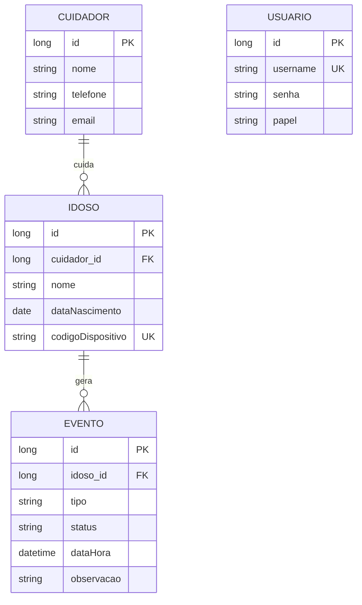

# CitizenTech – API "Idoso em casa com mais segurança" (Java Advanced)

**Integrantes:** Ilda Afonso | RM 568233 | Turma 2TDS
**Pitch (vídeo ≤ 5 min):** COLE-AQUI-O-LINK-DO-YOUTUBE

## O problema
Idosos que moram sozinhos ou passam o dia sem companhia sofrem quedas, esquecem remédios e demoram a receber ajuda.
O dispositivo em casa (Arduino/ESP32 com botão de emergência, sensor na caixa de remédios e sensor de movimento) envia
eventos para esta API, que os guarda e os entrega ao cuidador (app Mobile). Alinhado aos ODS 3 (Saúde e Bem-Estar) e 11 (Cidades Sustentáveis).

## Como rodar
Pré-requisitos: **JDK 17+** e **Maven 3.9+** (não precisa instalar banco: usa H2 em memória).
```
mvn spring-boot:run
```
A API sobe em http://localhost:8080 e carrega dados de exemplo automaticamente.

| Recurso | URL |
|---|---|
| Swagger (documentação e testes) | http://localhost:8080/swagger-ui.html |
| Health check (Actuator) | http://localhost:8080/actuator/health |
| Métricas (somente ADMIN) | http://localhost:8080/actuator/metrics |

### Usuários de teste
| Usuário | Senha | Papel | Pode |
|---|---|---|---|
| `admin` | `admin123` | ADMIN | tudo, inclusive DELETE e Actuator |
| `cuidador` | `cuidador123` | CUIDADOR | consultar, criar e editar (DELETE retorna 403) |

> Senhas só de demonstração (banco em memória). O segredo do JWT vem da variável `JWT_SECRET` (há um valor de desenvolvimento por padrão, que deve ser trocado em produção).

### Testando rápido (PowerShell)
```
$r = Invoke-RestMethod -Method Post -Uri http://localhost:8080/api/auth/login -ContentType "application/json" -Body '{"username":"admin","senha":"admin123"}'
Invoke-RestMethod -Uri http://localhost:8080/api/eventos -Headers @{Authorization="Bearer $($r.token)"}
```

## Arquitetura
Camadas: `controller` (REST + HATEOAS) → `service` (regras e cache) → `repository` (Spring Data JPA) → H2.
DTOs (`record`) separam o contrato da API das entidades; `exception` centraliza os erros; `security` trata o JWT.



## Endpoints principais
| Método | Rota | Descrição |
|---|---|---|
| POST | `/api/auth/login` · `/api/auth/registro` | JWT |
| GET/POST/PUT/DELETE | `/api/cuidadores` | CRUD paginado |
| GET | `/api/cuidadores/{id}/idosos` | idosos do cuidador (cache) |
| GET | `/api/cuidadores/{id}/resumo` | eventos pendentes (JPQL, cache) |
| GET/POST/PUT/DELETE | `/api/idosos` | CRUD paginado |
| GET | `/api/eventos?idosoId=&tipo=&status=&de=&ate=&page=&size=&sort=dataHora,desc` | filtros dinâmicos + paginação |
| POST | `/api/eventos` | registro de evento (usado pelo dispositivo) |
| PATCH | `/api/eventos/{id}/resolver` | cuidador resolve o alerta |

Regras de negócio: gravidade calculada pelo tipo (botão = CRÍTICA, sem movimento = ALTA, remédio não tomado = MÉDIA, remédio tomado = BAIXA); dispositivo único por idoso (409 se repetido).

## Justificativa técnica
**Consultas (3 estratégias, cada uma onde faz mais sentido)**
- *Query method derivada* (`findByCuidadorIdOrderByNomeAsc`, `findByCodigoDispositivo`): consultas simples e legíveis, sem SQL escrito.
- *JPQL com `@Query`* (`contarPorCuidadorEStatus`): precisa de join Evento→Idoso→Cuidador e contagem; o nome derivado ficaria ilegível.
- *Specification* (`EventoSpecs`): o filtro de eventos tem 5 parâmetros opcionais; montar a consulta dinamicamente evita dezenas de métodos.

**Cache (Spring Cache)**: `resumoCuidador` e `idososDoCuidador` são as telas mais acessadas do app e mudam pouco; são invalidadas (`@CacheEvict`) em qualquer criação/alteração/exclusão, evitando dados desatualizados. Cache em memória (simples) por ser um projeto acadêmico de instância única; em produção seria Redis.

**Segurança**: Spring Security stateless com JWT (HS256, 2h). Senhas com BCrypt. Dois papéis: ADMIN (exclusões e Actuator) e CUIDADOR. 401 sem token, 403 sem permissão. CORS configurável (`CORS_ORIGENS`) para o app.

**Erros padronizados**: `@RestControllerAdvice` devolve JSON único (`timestamp, status, erro, mensagem, detalhes`) para 400 (validação/JSON/enum/ordenação), 401, 404, 409 e 500 sem expor detalhes internos.

**HATEOAS**: respostas trazem links (`self`, `idosos`, `resumo`, `cuidador`, `eventos`, `resolver`) e as listas trazem metadados de paginação.

**Observabilidade**: Actuator (`health`, `info`, `metrics`).

## Declaração de uso de IA
Utilizei o Claude (Anthropic) como apoio para estruturar o projeto e gerar código base. Revisei o conteúdo, executei e entendo o funcionamento de cada parte.
